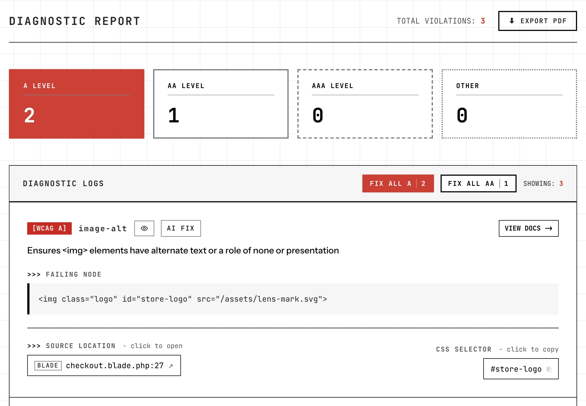
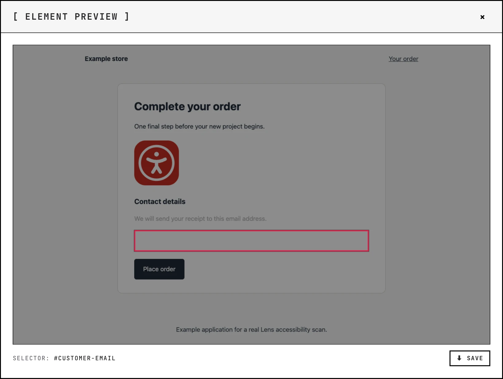

<p align="center">
  <a href="https://lens.lipinskijakub.pl">
    <picture>
      <source media="(prefers-color-scheme: dark)" srcset="art/readme/logo-dark.svg">
      
    </picture>
  </a>
</p>

<p align="center">
  <a href="https://packagist.org/packages/webcrafts-studio/lens-for-laravel"></a>
  <a href="https://packagist.org/packages/webcrafts-studio/lens-for-laravel"></a>
  <a href="https://github.com/webcrafts-studio/lens-for-laravel/stargazers"></a>
  <a href="LICENSE.md"></a>
</p>

<p align="center">
  Accessibility, closer to your code.<br>
  <a href="https://lens.lipinskijakub.pl/docs/introduction">Documentation</a> ·
  <a href="https://lens.lipinskijakub.pl">Website</a> ·
  <a href="https://github.com/webcrafts-studio/lens-for-laravel/issues">Report an issue</a>
</p>

## About Lens

Lens for Laravel finds accessibility issues in your rendered application, maps them to source files, and helps you review fixes in the dashboard. Powered by axe-core and Chromium.

- **Scan your app:** individual pages, whole websites, interactive states, and pages behind login.
- **Find the source:** Blade, Livewire, React, Vue, and Inertia projects.
- **Review AI fixes:** editable suggestions, diff previews, cloud providers, and local Ollama models.
- **Track progress:** scan history, comparisons, element previews, PDF reports, and CI baselines.

<picture>
  <source media="(prefers-color-scheme: dark)" srcset="art/readme/audit-dark.webp">
  
</picture>

<details>
<summary>See an element preview</summary>

<picture>
  <source media="(prefers-color-scheme: dark)" srcset="art/readme/preview-dark.webp">
  
</picture>

</details>

## Quick start

Requires **PHP 8.2+**, **Laravel 10-13**, Node.js, and Chromium. Use Lens in local or controlled development environments.

```bash
composer require webcrafts-studio/lens-for-laravel --dev
npm install puppeteer --save-dev
php artisan lens:install
```

Open `/lens-for-laravel/dashboard` in your application, or run:

```bash
php artisan lens:audit --aa --wcag=2.2
```

WCAG 2.0 is the default; `--wcag=2.2` includes the earlier rule sets. See the [installation guide](https://lens.lipinskijakub.pl/docs/installation) for optional history and configuration.

**AI Fix is optional:** PHP 8.3+, Laravel 12+, and `laravel/ai` are required. [Set up AI Fix](https://lens.lipinskijakub.pl/docs/ai-fix-engine)

AI requests send bounded source context to the configured provider. Default localhost Ollama processing stays on the application host; cloud providers and remote Ollama endpoints receive that context over the network. Applied fixes remain pending and counted until a fresh scan verifies them.

## Use Lens with your coding assistant

Connect Codex or Claude Code to the same Lens scanner through the optional official `laravel/mcp` package. Ask your assistant to scan a page, inspect findings, edit the source, and verify the changes with a fresh audit.

```bash
composer require laravel/mcp --dev
php artisan lens:mcp:install --client=codex
```

Use `--client=claude` for Claude Code, then reconnect your assistant. It starts the local MCP server automatically. Lens MCP requires PHP 8.2+ and Laravel 10.49+; it uses your assistant's model and does not require `laravel/ai`.

[Setup, tools, and long scans](https://lens.lipinskijakub.pl/docs/mcp).

## Documentation

[Scanning modes](https://lens.lipinskijakub.pl/docs/scanning-modes) · [Configuration](https://lens.lipinskijakub.pl/docs/configuration) · [CLI & CI](https://lens.lipinskijakub.pl/docs/cli-reference) · [AI Fix](https://lens.lipinskijakub.pl/docs/ai-fix-engine) · [Lens MCP](https://lens.lipinskijakub.pl/docs/mcp)

Upgrade guides: [v3](https://lens.lipinskijakub.pl/docs/upgrade-v3) · [v2.1](https://lens.lipinskijakub.pl/docs/upgrade-v2-1) · [v2](https://lens.lipinskijakub.pl/docs/upgrade-v2).

> Automated checks do not prove full WCAG conformance. Always complement scans with manual keyboard and screen reader testing. Source mapping is heuristic.

Lens for Laravel is open source under the [MIT license](LICENSE.md).
